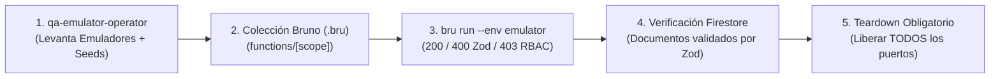

# 🧪 MXD Bruno Cloud Functions QA (`bruno-qa`)

Este skill gobierna la **validación funcional de backend (`functions/[scope]`)** en la cadena de desarrollo continuo. Mientras `qa-regression-tester` y `browser` validan la interfaz web, `bruno-qa` certifica las Cloud Functions (HTTP endpoints y `onCall` callables) ejecutando colecciones de **Bruno** contra los emuladores locales de Firebase.



---

## 🎯 Disparadores

- `/bruno-qa`, `/cf-qa`, `/test-functions`
- `"validar cloud functions con bruno"`, `"probar CFs en emulador"`, `"correr bruno contra emuladores"`
- Invocado automáticamente en la **Fase 5 (Validación Funcional)** del pipeline continuo cuando el diff modifica `functions/[scope]`.

---

## 🧭 1. Protocolo Operativo en 5 Pasos

### Paso 1: Preparación de Emuladores y Seeds
1. Delegar o coordinar con el subagente **`qa-emulator-operator`** para:
   - Verificar que no haya procesos huérfanos ocupando puertos de Firebase Emulators (`4000`, `5001`, `8080`, `9000`, `9099`, etc.).
   - Compilar `functions/[scope]` y levantar los emuladores (`functions`, `firestore`, `auth`) con las semillas de prueba (`seeds`).
   - Obtener tokens o credenciales de usuarios de prueba (admin, operador, usuario sin permisos) desde el emulador de Auth.

### Paso 2: Estructura de Colecciones Bruno por `scope`
Ubicar o crear la colección de Bruno del proyecto manteniendo correspondencia con `functions/[scope]`:

```text
bruno/
├── bruno.json
├── environments/
│   └── emulator.bru          # baseUrl: http://127.0.0.1:5001/<project-id>/<region>
└── [scope]/
    ├── 01-happy-path.bru     # Payload canónico válido -> 200 OK
    ├── 02-zod-invalid.bru    # Payload con tipos/campos inválidos -> 400 Bad Request
    ├── 03-unauthorized.bru   # Sin token o rol insuficiente -> 401 / 403
    └── 04-business-edge.bru  # Regla de negocio / idempotencia -> 404 / 409 / 422
```

> **Convención para Callables (`onCall`) de Firebase en Bruno:**
> Las funciones `onCall` reciben un `POST` con header `Content-Type: application/json`, `Authorization: Bearer {{authToken}}` y body envuelto en `{"data": { ... }}`, respondiendo con `{"result": { ... }}` (o `{"error": {"status": "...", "message": "..."}}`).

### Paso 3: Matriz Obligatoria de Casos `.bru` (Zod + Negocio)
Toda Cloud Function nueva o modificada en `functions/[scope]` debe probar al menos estos 4 vectores:

1. **Happy Path & Persistencia Limpia (`200 OK`)**:
   - Envía un payload válido conforme al `*.schema.ts` de `domain`.
   - Verifica en `tests {}` de Bruno que el status sea `200`, que el contrato devuelto cumpla los campos esperados y que el documento escrito en el emulador de Firestore cumpla el schema Zod (sin campos basura ni tipos corruptos).
2. **Zod Boundary Gate (`400 INVALID_ARGUMENT`)**:
   - Envía un payload que viole el schema Zod (ej. string enum inválido, campo requerido faltante, tipo numérico como string o propiedad no permitida).
   - Certifica que la función rechace la petición en la frontera con `400` / `INVALID_ARGUMENT` **y que no se haya escrito ningún documento parcial en Firestore**.
3. **Seguridad y RBAC (`401 UNAUTHENTICATED` / `403 PERMISSION_DENIED`)**:
   - Verifica que llamadas sin `Authorization` o con un usuario de otro tenant/rol sean rechazadas.
4. **Invariantes de Dominio e Idempotencia (`404` / `409` / `422`)**:
   - Verifica estados de negocio inválidos (ej. procesar dos veces una orden ya cerrada o operar sobre un recurso inexistente).

### Paso 4: Ejecución Automatizada vía CLI
Ejecutar la colección con Bruno CLI apuntando al entorno `emulator`:

```bash
npx @usebruno/cli run [scope] --env emulator --output /tmp/bruno-report-[scope].json
```

Si alguna aserción falla, inspeccionar logs de la Cloud Function en el emulador, reportar la causa exacta (`archivo:línea` en `functions/[scope]`) al subagente Coder para su corrección y re-ejecutar.

### Paso 5: Desocupación Obligatoria de Puertos (Teardown)
> **REGLA CRÍTICA:** Ninguna sesión de `bruno-qa` puede darse por terminada dejando emuladores encendidos.

Al concluir las pruebas (hayan pasado o fallado), ordenar a `qa-emulator-operator` detener los emuladores y verificar que todos los puertos (`5001`, `8080`, `9099`, `4000`, etc.) queden libres.

---

## 📄 2. Plantilla de Archivo `.bru` con Aserciones

```text
meta {
  name: Crear Orden - Rechazo por Schema Zod
  type: http
  seq: 2
}

post {
  url: {{baseUrl}}/createOrder
  body: json
  auth: bearer
}

auth:bearer {
  token: {{operatorToken}}
}

body:json {
  {
    "data": {
      "status": "ESTADO_INEXISTENTE_NO_CANONICO",
      "total": -100
    }
  }
}

tests {
  test("Debe rechazar payload inválido según Zod schema con 400", function() {
    expect(res.getStatus()).to.equal(400);
  });
}
```
