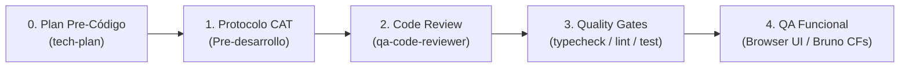
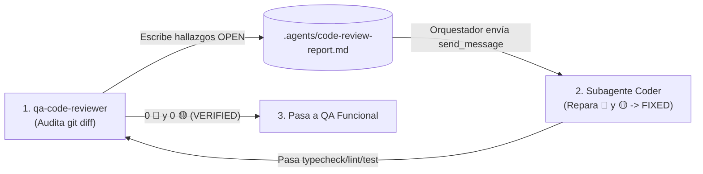

# 🛡️ MXD Quality Gates & Code Review Hub (`code-review`)

Este Super-Skill unifica el aseguramiento de calidad en cualquier proyecto de Marxa Digital, conectando la definición preventiva de [tech-plan](file:///Users/jgu7man/.gemini/config/skills/tech-plan/SKILL.md) y las reglas de arquitectura de [sanitize-architecture](file:///Users/jgu7man/.gemini/config/skills/sanitize-architecture/SKILL.md) con la validación post-código:



---

## 🎯 Disparadores y Modos de Operación

| Comando / Frase Clave                                         | Modo                       | Propósito                                                                                                                                |
| :------------------------------------------------------------ | :------------------------- | :--------------------------------------------------------------------------------------------------------------------------------------- |
| `/protocol-cat`, `/audit-debt`, `auditar deuda`               | **Fase 1: Pre-Dev (CAT)**  | Audita y sanea la deuda técnica de los archivos a tocar antes de programar la feature (cero `any`, string enums, schemas Zod faltantes). |
| `/code-review`, `revisa la HU`, `haz un code review`          | **Fase 2: Review (Diffs)** | Revisa exhaustivamente el diff de la rama actual contra la rama base y contra el Plan de Implementación / Criterios de la HU.            |
| `/review-loop`, `itera el code review`, `corrige el review`   | **Fase 2B: Bucle Review ⇄ Coder** | Ejecuta `qa-code-reviewer`, guarda hallazgos en `.agents/code-review-report.md` e itera automáticamente con el subagente Coder hasta dejar `0 🔴` y `0 🟡`. |
| `/codebase-audit`, `auditoría de código`                      | **Fase 3: Auditoría 5D**   | Auditoría estática integral sobre un `scope` o librería en 5 dimensiones (arquitectura Nx, clean code, dead code, boundaries, testing).  |
| `/feature-verify`, `/integrity-check`, `verificar integridad` | **Fase 4: Pre-PR (Gates)** | Ejecuta la batería mecánica antes del PR (`typecheck`, `lint`, `test`, `format`) y dispara validación funcional (UI o Bruno).            |

---

## 📋 1. Fase 1: Protocolo CAT (Clean Architecture & Anti-Technical-Debt)

Antes de codificar sobre un módulo existente, ejecuta la auditoría de saneamiento guiada por el Plan de Implementación:

1. **Regla del Scout**: Todo archivo tocado debe quedar sin antipatrones heredados. _(Excepción: en un flujo `/hotfix-deploy` de emergencia en producción, limitar los cambios a la reparación quirúrgica y registrar la deuda restante)._
2. **Cero `any` y Cero Tipos Anónimos Inline**:
   - Todo parámetro, retorno o propiedad debe usar interfaces o tipos canónicos de `domain` (`*.model.ts`).
3. **String Enums + Schemas Zod en Frontera de DB**:
   - Catálogos de estado siempre con `export enum ...` y validados en `domain` con `z.nativeEnum(...)` dentro de `*.schema.ts`.
4. **Cero Boolean Leakage**:
   - Reemplazar asignaciones `condicion && valor` por ternarios explícitos `condicion ? valor : undefined`.

👉 _Referencia detallada:_ [Protocolo CAT](file:///Users/jgu7man/.gemini/config/skills/code-review/references/cat-protocol.md) y [Regla del Scout](file:///Users/jgu7man/.gemini/config/skills/code-review/references/scout-rule.md).

---

## 🔎 2. Fase 2: Code Review Exhaustivo e Iterativo de Diffs

Aplica el checklist sobre el `git diff` (ejecutable mediante el subagente global **`qa-code-reviewer`**).

### 🔁 Bucle de Reparación Continua (`.agents/code-review-report.md`)

Para que el subagente **Coder** y el **Revisor (`qa-code-reviewer`)** iteren hasta dejar el código impecable sin perder hallazgos entre rondas, toda revisión se persiste en **`.agents/code-review-report.md`** (en la raíz del workspace):



1. **Formato del Archivo `.agents/code-review-report.md`**:
   ```markdown
   # Code Review Report — Rama: `feature/mps-1042` (Ronda N)
   - **Estado Global**: `CHANGES_REQUESTED` | `APPROVED`
   - **Conteo Activo**: 🔴 Bloqueantes: X | 🟡 Deuda Técnica: Y | 🟢 Scout: Z

   | ID | Severidad | Archivo:Línea | Regla Violada | Acción Requerida | Estado |
   | :--- | :--- | :--- | :--- | :--- | :--- |
   | CR-01 | 🔴 Bloqueante | `orders.service.ts:42` | Sin validación Zod al guardar | Usar `OrderWriteSchema.parse(payload)` | `OPEN` |
   | CR-02 | 🟡 Deuda | `order-card.html:18` | Método en template | Extraer a Pure Pipe o `computed()` | `OPEN` |
   ```
2. **Protocolo de Iteración (`Revisor ⇄ Coder`)**:
   - **Ronda $N$ (Revisor)**: `qa-code-reviewer` audita el diff y el Orquestador vuelca los hallazgos en `.agents/code-review-report.md` con estado `OPEN`.
   - **Reparación (Coder)**: si existen hallazgos 🔴 o 🟡 en estado `OPEN`, el Orquestador reutiliza el mismo subagente Coder vía **`send_message`** (con su `conversationId`) indicándole leer `.agents/code-review-report.md`, corregir cada punto, cambiar su estado a `FIXED` y correr `nx affected -t typecheck,lint,test`.
   - **Re-verificación (Ronda $N+1$)**: `qa-code-reviewer` vuelve a auditar el diff; marca los puntos resueltos como `VERIFIED` (o los reabre a `OPEN` si persisten).
   - **Condición de Salida**: El bucle solo termina cuando `.agents/code-review-report.md` alcanza **`Estado Global: APPROVED` (`0 🔴 Bloqueantes` y `0 🟡 Deuda Técnica`)** o tras un máximo de **4 rondas** (en cuyo caso escala al desarrollador humano).

### Capa 1 — Antipatrones de Angular, Rendimiento y Accesibilidad (`feature` & `ui`)

- **Cero Métodos en Plantillas HTML**:
  - ❌ `{{ formatMoney(item.amount) }}` o `[title]="getLabel(item)"`.
  - ✅ Usar **Pure Pipes** en `utils` o `computed()` en el componente/engine.
- **Optimización con `@let` y Signals**:
  - ❌ Invocar repetidamente un signal en template (`order().name`, `order().total`).
  - ✅ Capturar con `@let ord = order();` al inicio del bloque.
- **Descomposición Atómica (`feature` vs `ui`) y Archivos Externos**:
  - Componentes en `feature` con más de **250 líneas de HTML** deben extraer moléculas presentacionales hacia `ui` con `ChangeDetectionStrategy.OnPush` e `input.required<T>()`.
  - Todo componente Angular debe usar archivos externos (`templateUrl` y `styleUrl`); prohibido HTML (`template:`) o CSS (`styles:`) inline en archivos `.ts`.
  - **Modales Independientes**: Todo modal/diálogo debe extraerse a su propio componente con template `.html` dedicado (`*-modal.component.ts` + `*-modal.component.html`), nunca incrustado inline en el HTML de la vista padre.
  - **Bloques `@if`/`@else` Grandes**: Cuando una rama `@if`/`@else` (o `@switch`) en HTML sea extensa (>40–50 líneas o con formularios/subestados propios), extraerla como componente hijo `OnPush` con su propio `.html` para mantener la plantilla contenedora limpia y modular.
- **Accesibilidad (A11y)**:
  - Todo elemento interactivo con `(click)` debe incluir `(keyup.enter)` y botones icónicos deben tener `aria-label`.
- **Badges y Píldoras (Record Pattern)**:
  - ❌ Prohibido `@switch`/`@case` repetitivos para estilos de estado.
  - ✅ Usar `Record<EnumType, VisualConfig>` en `*-ui.model.ts` y un único `<span>` declarativo.

### Capa 2 — Fronteras Nx (`scope` + `type`), Modelos y Persistencia Zod

Auditar contra la fuente única de verdad en [sanitize-architecture](file:///Users/jgu7man/.gemini/config/skills/sanitize-architecture/SKILL.md):

- **Jerarquía de 4 Niveles**:
  1. `marxa-digital/[scope]/{api,feature,data-access,domain,ui,utils}`
  2. `shared/{api,feature,data-access,domain,ui,utils}/[scope]`
  3. `modules/[scope]/{api,feature,data-access,domain,ui,utils}`
  4. `functions/[scope]`
- **Zod Gate Obligatorio en Base de Datos (🔴 Bloqueante si falta)**:
  - Toda escritura a Firestore/RTDB en `data-access` o `functions/[scope]` debe validar el payload con `Schema.parse(...)` definido en `domain/*.schema.ts`.
  - Prohibido persistir o hidratar documentos con casts ciegos (`as Entity`). Datos legados deben normalizarse con `BoundaryTransformer` + `safeParse()`.
- **Cero Silenciamiento de Errores (🔴 Bloqueante)**:
  - Prohibido atrapar excepciones en `catch` y limitarlas a `console.error(...)` o bloques vacíos. Todo `catch (error: unknown)` en componentes, guards o servicios debe reportar el error al `ErrorHandler` (`this.errorHandler.handleError(error)`) o telemetría oficial además de actualizar el estado de UI.
- **Higiene de Contratos y Clases**:
  - Segmentación estricta: `*.model.ts` y `*.schema.ts` en `domain`; `*-copys.model.ts` y `*-ui.model.ts` en `ui`.
  - **Cero interfaces `*Like`**, cero wrappers de una sola línea, cero alias de exportación redundantes y modificadores explícitos (`private`, `protected`, `public`, `readonly`).
- **Desacoplamiento White-Label (Headless Engine)**:
  - La lógica de negocio pesada no vive en el componente visual, sino en un `*Engine.ts` o helper puro en `domain` con su `*.spec.ts`.
- **Feedback Loop Tests → Arquitectura (Sensor SRP, Archivos Migrados & Lenguaje Humano)**:
  - Todo hallazgo al auditar o redactar `*.spec.ts` donde un método (incluidos métodos `private` en archivos movidos o migrados hacia `data-access`) mezcle I/O + algoritmos puros (sorteos, validaciones de dominio, mappers, `.filter/.map/.sort`) o múltiples efectos cross-dominio debe escalarse en el reporte de review como candidato de extracción SRP hacia `domain`/`utils` (TDD Red → Green) y reflejarse en `business-specs.md`.
  - Rechazar pruebas con jerga críptica sin contexto de negocio o `throw` ficticios cuyo modo de fallo no exista en el código real (priorizar `describe('Cuando <contexto>')` + `beforeEach` + `it` atómicos que validen garantías de negocio y rechazos de schemas Zod).

👉 _Referencia detallada:_ [Guía de Antipatrones de Angular](file:///Users/jgu7man/.gemini/config/skills/code-review/references/angular-antipatterns.md) y [Fronteras por Scope y Type](file:///Users/jgu7man/.gemini/config/skills/code-review/references/models-boundaries.md).

---

## 🏛️ 3. Fase 3: Auditoría 5D de Codebase

Evalúa cualquier `scope` bajo las 5 dimensiones:

1. **Arquitectura y Estructura Nx**: Separación limpia `api`, `feature`, `data-access`, `domain`, `ui`, `utils` y `functions/[scope]`.
2. **Clean Code, Tipado y Zod**: Cero `any`, cero código defensivo sospechoso (Fail-Fast), cero casts sin validación Zod en frontera de persistencia, contratos canónicos sin `*Like`.
3. **Dead Code & Duplicidad**: Erradicación de código muerto y duplicación (`jscpd`).
4. **Module Boundaries**: Cumplimiento estricto de tags en `eslint.config.*` (`enforce-module-boundaries`).
5. **Cobertura, Realismo y Sensor SRP en Testing**: Pruebas unitarias de helpers, engines y schemas Zod en `domain`/`utils`/`functions` aislados de I/O usando `describe` + `beforeEach` + `it` atómicos, lenguaje humano con causas reales de fallo, sincronización con `business-specs.md` y detección de métodos sobrecargados expuestos por las pruebas.

👉 _Referencia detallada:_ [Matriz de Auditoría 5D](file:///Users/jgu7man/.gemini/config/skills/code-review/references/matriz-auditoria.md).

---

## 🚀 4. Fase 4: Quality Gates Pre-PR y Validación Funcional

Antes de confirmar la entrega o abrir el PR, ejecuta la batería mecánica obligatoria:

```bash
# 1. Typecheck estricto de librerías impactadas
pnpm exec nx affected -t typecheck

# 2. Linter (ESLint + Module Boundaries)
pnpm exec nx affected -t lint

# 3. Pruebas unitarias automatizadas con reporte de cobertura
pnpm exec nx affected -t test --coverage

# 4. Formateo determinista
pnpm exec nx format:write
```

Para validaciones pre-flight de Firestore y semillas locales (cuando el proyecto cuente con ellos):
- `scripts/verify-preflight.ts`: Auditoría de schemas, colecciones y tenants de prueba.
- `scripts/smoke-tests.ts`: Smoke tests de endpoints y triggers.

👉 _Referencia de usuarios de prueba:_ [Test Users & Tenants](file:///Users/jgu7man/.gemini/config/skills/code-review/references/test-users.md).

### Compuerta de Validación Funcional Post-Gates

Una vez aprobados los gates estáticos:

- **Si el cambio impacta Frontend (`feature` / `ui` / `data-access`)**: invocar validación en navegador contra emuladores vía `qa-reviewing` (`qa-emulator-operator` + `qa-regression-tester` / `browser`).
- **Si el cambio impacta Cloud Functions (`functions/[scope]`)**: invocar validación de endpoints/callables con Bruno vía [bruno-qa](file:///Users/jgu7man/.gemini/config/skills/bruno-qa/SKILL.md) (`qa-emulator-operator` + `bru run --env emulator`).
- **Al finalizar**: verificar siempre que todos los puertos de emuladores hayan sido liberados.
