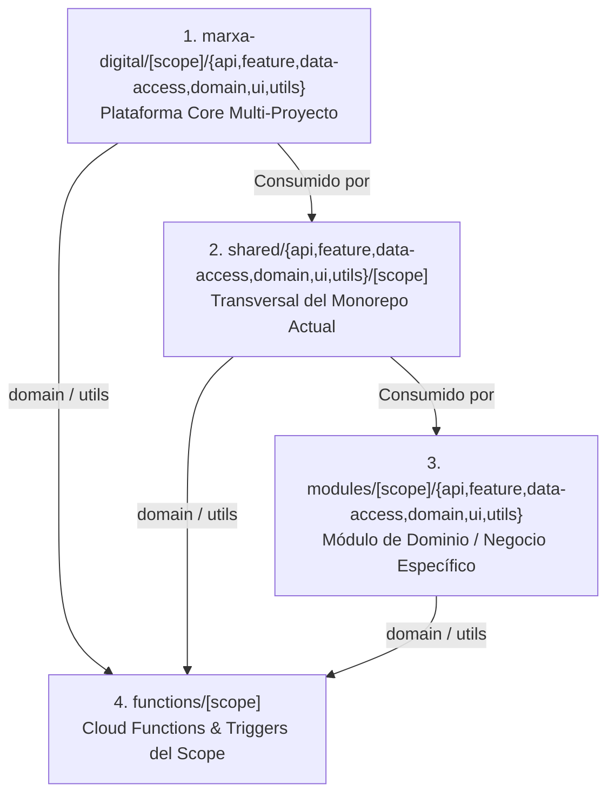

# Regla de Arquitectura: Fronteras por `scope` y `type` (Module Boundaries)

## 1. Principio Fundamental

Queda estrictamente **prohibido contaminar las librerías transversales (`marxa-digital/*` o `shared/*`) con conceptos, enums, tarifas o catálogos específicos de un módulo de negocio (`modules/[scope]`)**, así como mezclar responsabilidades entre tipos de librería (`domain`, `data-access`, `ui`, `feature`, `api`, `utils`).

La arquitectura sigue una jerarquía agnóstica de **4 niveles**:

---

## 2. Reglas de Dependencia por Nivel

### Nivel 1: `marxa-digital/[scope]/*`
- **Propósito**: Piezas core reutilizables en cualquier proyecto de Marxa Digital (auth base, componentes UI atómicos, utilidades transversales, clientes base).
- **Restricción**: **Nunca** importa de `shared/*`, `modules/*` ni `functions/*`.

### Nivel 2: `shared/{type}/[scope]`
- **Propósito**: Contratos, componentes, acceso a datos y utilidades compartidas por múltiples módulos dentro del mismo monorepo.
- **Restricción**: Puede importar de `marxa-digital/*` y de otros `shared/*` (respetando las reglas de `type`), pero **nunca** de `modules/*`.

### Nivel 3: `modules/[scope]/{type}`
- **Propósito**: Lógica, vistas, estado y modelos propios de un módulo o vertical de negocio (ej. `orders`, `catalog`, `billing`, `attendance`).
- **Restricción**: No puede importar archivos internos (`domain`, `data-access`, `feature`, `ui`) de otro `modules/[otro-scope]`. Toda interacción entre módulos distintos debe pasar por `modules/[otro-scope]/api`.

### Nivel 4: `functions/[scope]`
- **Propósito**: Cloud Functions (HTTP, Callables, Firestore/Auth triggers, tareas programadas) del `scope`.
- **Restricción**: Solo puede compartir contratos (`*.model.ts`), schemas Zod (`*.schema.ts`) y funciones puras desde librerías `type:domain` o `type:utils`. **Prohibido** importar de `ui` o `feature`.

---

## 3. Matriz de Dependencias por `type`

| Tipo de Librería | Puede importar de (`type`) | Contenido Principal |
| :--- | :--- | :--- |
| **`type:domain`** | `domain`, `utils` | `*.model.ts`, `*.schema.ts` (Zod), string enums, engines/lógica pura sin I/O. |
| **`type:data-access`** | `data-access`, `domain`, `utils` | Repositorios Firestore/HTTP, stores, validación `Schema.parse()` / `safeParse()`, `BoundaryTransformer`. |
| **`type:ui`** | `ui`, `domain`, `utils` | Componentes presentacionales `OnPush`, `*-ui.model.ts`, `*-copys.model.ts`. |
| **`type:feature`** | `feature`, `ui`, `data-access`, `domain`, `utils`, `api` | Smart components / páginas (`*PageComponent`), rutas, orquestación de casos de uso. |
| **`type:api`** | `domain`, `data-access`, `utils` | Contratos y facades públicos expuestos hacia otros `modules/[otro-scope]`. |
| **`type:utils`** | `utils` | Helpers puros, pipes puros y validadores sin estado. |
