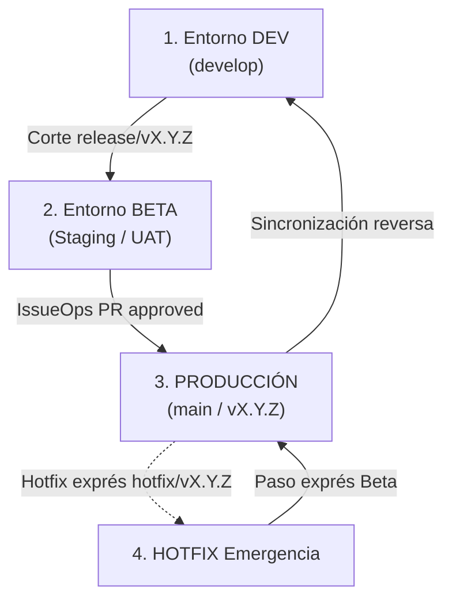
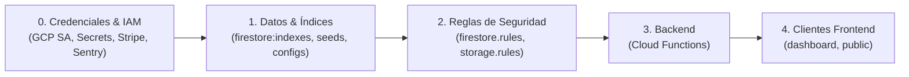

# 🚀 MXD DevOps & CI/CD Lifecycle Hub (`deploy`)

Este Super-Skill gobierna la infraestructura, automatización de Git, IssueOps y despliegues continuos para todos los entornos de Marxa Digital:



---

## 🎯 Disparadores y Modos de Despliegue

| Comando / Frase Clave | Entorno / Flujo | Rama Base | Acción Principal |
| :--- | :--- | :--- | :--- |
| `/develop-deploy`, `/develop`, `desplegar a dev` | **Desarrollo (DEV)** | `develop` | Valida PR hacia develop, dispara `manual-hosting-deploy.yml` vía gh CLI y verifica canal preview. |
| `/beta-deploy`, `/beta`, `desplegar a beta` | **Staging / UAT (BETA)** | `release/vX.Y.Z` | Corta rama release desde develop, audita tickets Jira, abre PR a main, aplica etiqueta `approved` y certifica `-beta.N`. |
| `/production-deploy`, `/production`, `desplegar a prod` | **PRODUCCIÓN** | `main` | IssueOps formal: abre Issue de despliegue, procesa etiqueta `approved`, ejecuta auto-merge `--no-ff`, tagging y certificación. |
| `/hotfix-deploy`, `/hotfix`, `hotfix de emergencia` | **HOTFIX Exprés** | `hotfix/vX.Y.Z` | Corta directo desde `main`, sanea quirúrgicamente, valida en beta exprés, promueve a prod y sincroniza main hacia develop. |

---

## 🛡️ Protocolo Obligatorio: Auditoría Pre-Release y Orden Canónico

> **REGLA FUNDAMENTAL: "Credentials & IAM First, Data & Backend Second, UI Last"**  
> Desplegar una versión **NUNCA** se limita a compilar y publicar el frontend. Desplegar clientes web antes de que su infraestructura de soporte esté activa o con credenciales expiradas ocasiona bloqueos de permisos (`PERMISSION_DENIED`), fallos de índices (`FAILED_PRECONDITION`) y caídas de servicio.

### 1. Auditoría Pre-Release (Target Discovery)
Antes de abrir un PR de release o disparar un despliegue, es obligatorio auditar el diff acumulado frente a `main`:
```bash
git diff origin/main...HEAD --name-only
```
Se inspeccionan las dimensiones clave para definir prerrequisitos y targets:
0. **Credenciales, Permisos e IAM (Fase 0)**:
   - Validar roles IAM en Google Cloud (`roles/firebasehosting.admin`, `roles/cloudfunctions.developer`, `roles/serviceusage.serviceUsageConsumer`, `roles/storage.admin`, etc.).
   - Diagnóstico rápido: `./.agents/skills/cicd-env-doctor/scripts/check-env.sh`.
   - Comprobar rotación y expiración de Service Account Keys y GitHub Secrets (`FIREBASE_SERVICE_ACCOUNT`).
   - Validar proveedores externos: correspondencia de llaves en Stripe (Live vs Test), DSN/token activo en Sentry y secrets de repositorios.
1. **Índices de Firestore**: Cambios en `firestore.indexes.json` $\rightarrow$ Despliegue previo `firebase deploy --only firestore:indexes`.
2. **Seguridad**: Cambios en `firestore.rules` o `storage.rules` $\rightarrow$ Target obligatorio `rules` o despliegue previo por CLI.
3. **Backend / Cloud Functions**: Cambios en `functions/**` $\rightarrow$ Target obligatorio `functions`.
4. **Master Data & Seeds**: Nuevos documentos de configuración en Firestore (`plans`, `legalTemplates`, `profiles`, remote config) $\rightarrow$ Sembrado y validación previa en base de datos.
5. **Frontend Apps**: `dashboard`, `public`, `tenant-landing`, etc.

### 2. Orden Canónico de Despliegue


---

## 🛠️ 1. Entorno de Desarrollo (DEV)

- **Objetivo**: Integración continua en la rama `develop` para pruebas preliminares.
- **Workflow**:
  1. Validar que el branch de trabajo tenga PR abierto hacia `develop`.
  2. Ejecutar validación de calidad previa (`/code-review`).
  3. Disparar workflow on-demand con GitHub CLI:
     ```bash
     gh workflow run manual-hosting-deploy.yml --ref develop
     ```
  4. Monitorear el progreso del run hasta finalizar exitosamente.
  5. Asistir en el **Squash Merge** hacia `develop`.

👉 *Referencia detallada:* [Playbook de Desarrollo](file:///Users/jgu7man/.gemini/config/skills/deploy/references/dev-playbook.md).

---

## 🧪 2. Entorno BETA (Staging / UAT)

- **Objetivo**: Estabilizar y certificar la versión candidata (`release/vX.Y.Z`).
- **Workflow**:
  1. Verificar que `develop` esté limpio y con tests pasando.
  2. Cortar rama de release: `git checkout -b release/vX.Y.Z develop`.
  3. Auditar tickets de Jira incluidos frente a `main` y actualizar su `fixVersion`.
  4. Abrir PR desde `release/vX.Y.Z` hacia `main`.
  5. Autorizar despliegue aplicando la etiqueta `approved`:
     ```bash
     gh pr edit <PR_NUMBER> --add-label "approved"
     ```
  6. Monitorear `deploy-beta-pr-approved.yml` hasta la certificación exitosa de la versión `-beta.N`.

👉 *Referencia detallada:* [Playbook de Beta](file:///Users/jgu7man/.gemini/config/skills/deploy/references/beta-playbook.md).

---

## 🚢 3. Entorno de PRODUCCIÓN (IssueOps)

- **Objetivo**: Despliegue gobernado, auditable y seguro hacia producción con auto-merge `--no-ff`.
- **Workflow**:
  1. La versión candidata debe estar previamente certificada en Beta.
  2. Crear el Issue de despliegue formal con la plantilla ejecutiva.
  3. Solicitar confirmación explícita del Tech Lead / Usuario antes de aplicar la etiqueta `approved`.
  4. Aplicar etiqueta `approved` sobre el Issue de despliegue para detonar `issueops-deploy.yml`.
  5. El workflow compila, despliega a Hosting/Functions, realiza el merge `--no-ff` a `main`, genera el tag `vX.Y.Z` y registra la certificación en Firestore.
  6. **Paso Obligatorio Post-Deploy**: Sincronizar `main` hacia `develop` para mantener paridad:
     ```bash
     git checkout develop && git merge main && git push origin develop
     ```

👉 *Referencia detallada:* [Gobernanza IssueOps de Producción](file:///Users/jgu7man/.gemini/config/skills/deploy/references/production-issueops.md).

---

## 🚨 4. Flujo HOTFIX de Emergencia

- **Objetivo**: Reparar una falla crítica activa en producción en minutos sin arrastrar cambios pendientes de `develop`.
- **Workflow**:
  1. Cortar rama directamente desde `main`: `git checkout -b hotfix/vX.Y.Z main`.
  2. Reparación quirúrgica de código aplicando el Protocolo CAT.
  3. Ejecutar Quality Gates estrictos en local (`nx affected -t test,lint,typecheck`).
  4. Despliegue exprés a Beta para verificación manual.
  5. Promoción gobernada a Producción.
  6. **Sincronización Doble Obligatoria**: Merge a `main` y merge a `develop`.

👉 *Referencia detallada:* [Playbook de Hotfix](file:///Users/jgu7man/.gemini/config/skills/deploy/references/hotfix-playbook.md).

---

## 📚 Documentación de Gobernanza y Arquitectura
- [Gobernanza de Ambientes y Niveles de Aislamiento](file:///Users/jgu7man/.gemini/config/skills/deploy/references/gobernanza-ambientes.md)
- [Arquitectura Multi-Proyecto de Firebase](file:///Users/jgu7man/.gemini/config/skills/deploy/references/firebase-architecture.md)
