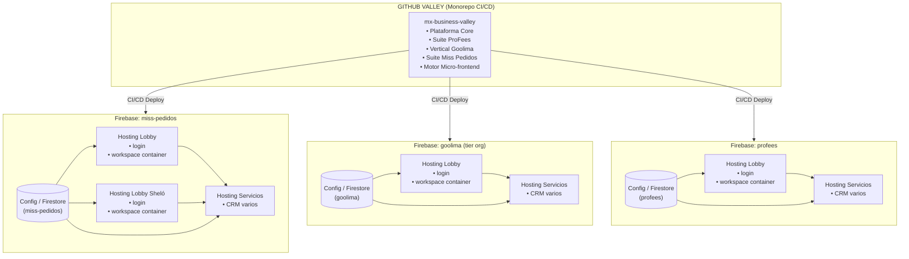

# Regla: Arquitectura Multi-Proyecto de Firebase (Edificios & Tier Orgs)

## 1. Visión General de Despliegue e Infraestructura

El monorepo **Valley** (`mx-business-valley`) contiene el código fuente unificado (Plataforma Core, Suites, Verticales, y el Micro-frontend Motor). Sin embargo, el despliegue mediante CI/CD se realiza hacia **múltiples proyectos independientes de Firebase**:

---

## 2. Principios Obligatorios de Firebase Multi-Proyecto

1. **Aislamiento por Proyecto de Firebase:**
   - **`miss-pedidos`**: Aloja su propia base de datos Firestore, Storage, Auth y sus hostings específicos (Lobby estándar, Lobby Sheló, Servicios).
   - **`goolima` (Tier Org)**: Aloja su propia base de datos Firestore, Storage, Auth y hostings exclusivos para la vertical de Goolima.
   - **`profees` (Suite Principal)**: Aloja la base de datos Firestore, Storage, Auth y hostings para la plataforma transversal de suscripciones y academias ProFees.

2. **Configuraciones de Firebase Dedicadas:**
   - Cada edificio/suite tiene su propio `firebase.<suite>.json` o targets específicos en `.firebaserc` y `firebase.json`.
   - Las reglas de seguridad (`firestore.rules`, `storage.rules`) y semillas (`seeds`) se ejecutan y aplican en el proyecto correspondiente.

3. **Arquitectura Micro-Frontend (Lobby + Motor/Servicios):**
   - Cada vertical u organización cuenta con un **Hosting Lobby** (autenticación, perfil, selector de tenants y workspace container).
   - El Lobby carga los módulos de **Hosting Servicios (Motor/CRM varios)** dinámicamente mediante Native Federation / Micro-frontends.
   - La colección/documento `config` en Firestore alimenta en tiempo de ejecución tanto al Lobby como a los Servicios.
