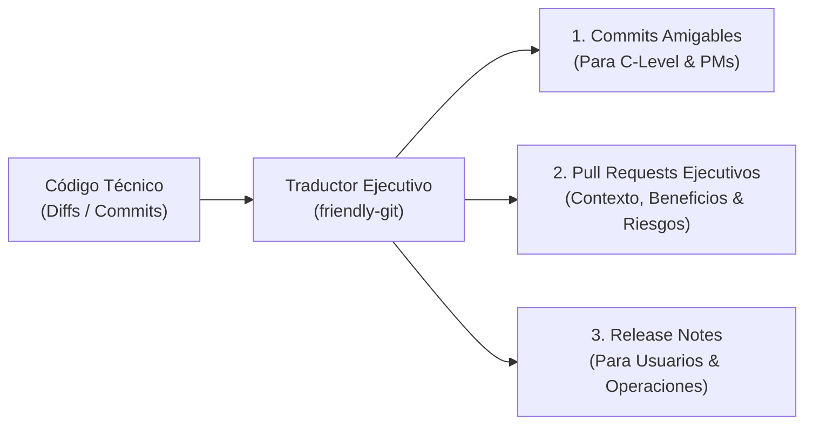

# 👔 MXD Executive Git & Release Hub (`friendly-git`)

Este Super-Skill estandariza la comunicación ejecutiva entre ingeniería y stakeholders de negocio, traduciendo cambios de código complejos en mensajes de alto impacto:



---

## 🎯 Disparadores y Modos de Uso

| Comando / Frase Clave | Modo | Propósito |
| :--- | :--- | :--- |
| `/friendly-commit`, `commit amigable` | **Commits Ejecutivos** | Redacta mensajes de commit en lenguaje simple, claro y libre de tecnicismos excesivos, vinculando siempre el ticket de Jira. |
| `/friendly-pr`, `pr ejecutivo` | **Pull Requests Ejecutivos** | Genera la descripción del PR explicando el valor de negocio, cambios visibles, consideraciones de riesgo y notas de rollback. |
| `/release-notes`, `genera release notes` | **Release Notes** | Analiza el diff de Git de la versión y genera notas de lanzamiento estructuradas enfocadas en beneficios al usuario final. |

---

## 📝 1. Directrices de Commits Ejecutivos

- **Objetivo**: Que un directivo o Product Manager comprenda de inmediato qué cambió sin tener que abrir el código.
- **Estructura Recomendada**:
  ```text
  tipo(área): Qué beneficio o solución se implementó (lenguaje humano)

  - Explicación breve de lo que mejora en la experiencia del usuario o negocio.
  - Corrección de comportamiento no deseado si aplica.

  Refs: TICKET-123
  ```
- **Reglas**:
  - Evitar jerga interna como *"refactorizado el observable switchMap del pipe"*.
  - Preferir *"optimizado el tiempo de respuesta al consultar pedidos"*.

👉 *Referencia detallada:* [Guía de Commits Ejecutivos](file:///Users/jgu7man/.gemini/config/skills/friendly-git/references/friendly-commits-guide.md).

---

## 📑 2. Estructura de Pull Requests Ejecutivos

Todo Pull Request debe responder las 4 preguntas esenciales para aprobación de stakeholders:

1. **¿Qué problema resuelve o qué valor aporta?** (Contexto de negocio en 2-3 líneas).
2. **¿Qué verá el usuario o cómo cambia la operación?** (Impacto visual o de flujo).
3. **¿Qué riesgos se mitigaron y cómo se probó?** (Evidencia de pruebas y seguridad).
4. **🔗 Jira**: Enlace directo al ticket correspondiente.

👉 *Referencia detallada:* [Guía y Plantilla de PR Ejecutivo](file:///Users/jgu7man/.gemini/config/skills/friendly-git/references/friendly-pr-guide.md).

---

## 📦 3. Generador Automatizado de Release Notes

Para generar notas de lanzamiento ejecutivas a partir del diff de Git o entre dos tags (`v1.2.0..v1.3.0`):

```bash
# Ejecutar el generador automatizado
pnpm exec ts-node ~/.gemini/config/skills/friendly-git/scripts/generate-notes.ts --from v1.2.0 --to HEAD
```

El script clasifica automáticamente los cambios en:
- 🌟 **Nuevas Funcionalidades** (Mejoras que habilitan nuevas capacidades).
- 🛠️ **Correcciones y Ajustes** (Problemas resueltos para el usuario).
- ⚡ **Rendimiento y Estabilidad** (Carga más rápida y mayor confiabilidad).

👉 *Referencia detallada:* [Estándar de Release Notes Orientadas al Usuario](file:///Users/jgu7man/.gemini/config/skills/friendly-git/references/release-notes-guide.md).
