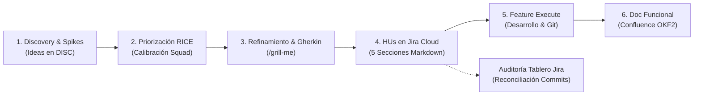

# 🎯 JG7 Product, Jira & Confluence Lifecycle Hub (`jira`)

Este Super-Skill gobierna de punta a punta el ciclo de vida de producto en JG7, conectando **Jira Product Discovery (DISC)**, **Jira Software (PROJ, MPS)** y **Confluence Cloud**:



---

## 🎯 Disparadores y Modos de Operación

| Comando / Frase Clave | Fase / Modo | Propósito |
| :--- | :--- | :--- |
| `/product-discovery`, `discovery` | **1. Discovery & Spikes** | Analiza ideas de negocio, viabilidad técnica, precedentes en el sistema, arquitectura preliminar y riesgos para Jira Discovery. |
| `/rice-estimation`, `estimar rice` | **2. RICE Scoring** | Calcula Reach, Impact, Confidence y Effort considerando la capacidad operativa real del equipo (+ colchón 20-30%). |
| `/grill-me`, `/spec-planning` | **3. Refinamiento Gherkin** | Entrevista interactiva para resolver dudas de diseño, alinear especificaciones y definir escenarios Gherkin completos. |
| `/jira-story`, `crear historia`, `redactar HU` | **4. Redacción de HU** | Redacta tickets de Jira en la plantilla corporativa de 5 secciones en Markdown nativo (cero Wiki Markup, diagramas ASCII). |
| `/feature-execute [KEY]`, `toma el ticket` | **5. Ejecución Autónoma** | Toma historias de usuario refinadas ("Ready for Dev"), asegura ramas git con el ticket, transiciona en Jira y orquesta el desarrollo. |
| `/doc-functional`, `documentación funcional` | **6. Doc en Confluence** | Redacta y publica la maquinaria operativa del software en Confluence (CÓMO/QUÉ/DÓNDE, cero narrativas temporales de antes/después). |
| `/jira-audit`, `auditar tablero jira` | **7. Auditoría de Tablero** | Reconcilia commits de Git con tickets de Jira, detecta gaps de tiempo trabajado y regulariza el backlog. |

---

## 📋 1. Estándar Oficial de Historias de Usuario (Jira Cloud)

- **Regla Estricta**: Usar **Markdown estándar** nativo (`##`, `###`, `**negrita**`, viñetas `-`, tablas `| --- |`). Queda estrictamente **prohibido Wiki Markup** (`h2.`, `||`) y diagramas **Mermaid** (el editor de Jira no los renderiza; usar diagramas ASCII dentro de bloques de texto plano ` ```text `).
- **Las 5 Secciones Obligatorias**:
  1. `## 1. Contexto de Negocio & Criterios de Aceptación (Gherkin)`: Escenarios en **3 viñetas principales** (`- **Dado**...`, `- **Cuando**...`, `- **Entonces**...`).
  2. `## 2. Análisis Técnico & Arquitectura`: Componentes, servicios, Cloud Functions o colecciones de Firestore involucradas.
  3. `## 3. Diagramas de Interacción (Plain Text / ASCII)`: Flujo paso a paso en texto plano.
  4. `## 4. Plan de Implementación por Fases`: Desglose secuencial de tareas.
  5. `## 5. Checklist de Verificación & Quality Gates`: Pruebas unitarias, lint, accesibilidad y visual testing.

👉 *Plantilla completa y ejemplos:* [Plantilla de Historias](file:///Users/jgu7man/.gemini/config/skills/jira/references/story-template.md) y [Ejemplo Canónico de HU](file:///Users/jgu7man/.gemini/config/skills/jira/examples/canonical-story-spec.md).

---

## ⚖️ 2. Estimación RICE Calibrada al Squad

- **Reach (Alcance)**: Número de usuarios impactados en el periodo (1 a 10).
- **Impact (Impacto)**: 3 = Masivo, 2 = Alto, 1 = Medio, 0.5 = Bajo, 0.25 = Mínimo.
- **Confidence (Confianza)**: 100% = Alta (certeza técnica), 80% = Media, 50% = Baja.
- **Effort (Esfuerzo)**: Escala 1 a 5 calibrada a:
  - Jorge Guzmán (Lead & Architect) + Antigravity (AI pair) + Auxiliar parcial.
  - Colchón obligatorio del 20% al 30% por imprevistos, juntas y validaciones forenses.
  - **Pregunta de calibración mensual**: Verificar con el usuario si la capacidad del squad se mantiene.

👉 *Guía detallada de estimación:* [Manual de Estimación RICE](file:///Users/jgu7man/.gemini/config/skills/jira/references/rice-estimation-guide.md).

---

## 📖 3. Documentación Funcional en Confluence Cloud

- **Objetivo**: Explicar **CÓMO FUNCIONA la maquinaria del sistema** para que cualquier ingeniero o líder de operaciones lo entienda de inmediato.
- **Las 3 Preguntas Obligatorias**:
  1. **¿Qué hace?** (Regla de negocio o proceso operativo).
  2. **¿Cómo lo hace?** (Maquinaria interna, contratos contables, listeners, mutaciones).
  3. **¿Dónde ocurre?** (Rutas de Firestore, endpoints, paths de componentes).
- **Cero narrativas temporales**: Prohibido hablar de "antes y después" o "planes futuros". Describe el sistema tal como opera **hoy**.

👉 *Estándar de documentación:* [Manual de Documentación Funcional](file:///Users/jgu7man/.gemini/config/skills/jira/references/doc-functional-standards.md).

---

## 📚 Documentación de Referencia Complementaria
- [Flujo de Product Discovery y Olas de Roadmap](file:///Users/jgu7man/.gemini/config/skills/jira/references/product-discovery-workflow.md)
- [Investigación Técnica y Spikes Preliminares](file:///Users/jgu7man/.gemini/config/skills/jira/references/research-spikes-guide.md)
- [Glosario Ubicuo de Dominio](file:///Users/jgu7man/.gemini/config/skills/jira/references/glosario-ubicuo.md)
- [Taxonomía de Contratos y Límites de Modelos](file:///Users/jgu7man/.gemini/config/skills/jira/references/taxonomy-contracts.md)
- [Gestión de Tickets y Épicas en Jira](file:///Users/jgu7man/.gemini/config/skills/jira/references/jira-management-playbook.md)
- [Auditoría y Regularización de Horas en Tablero Jira](file:///Users/jgu7man/.gemini/config/skills/jira/references/board-audit-guide.md)
