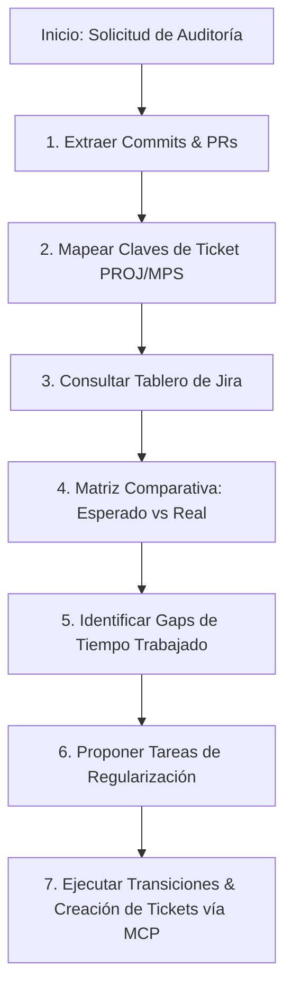

# Jira Board Audit & Codebase Reconciliation Skill

Use este skill cuando el usuario pida actuar como **Project Manager Auditor**, auditar un tablero de Jira (`PROJ`, `MPS`), reconciliar los avances del código con el estado del backlog remoto y regularizar el tiempo trabajado.

---

## 🔒 1. Credenciales y Seguridad

Por estándar mandatorio de JG7:

- **Estrategia Segura por Defecto**: Las credenciales de API de Atlassian deben guardarse exclusivamente en el archivo local de la máquina del desarrollador: `~/.jira.env` (fuera del control de versiones).
- **Formato del archivo `~/.jira.env`**:
  ```env
  JIRA_USER=tu-email@jg7.digital
  JIRA_TOKEN=tu_atlassian_api_token
  JIRA_URL=https://JG7.atlassian.net
  ```
- El servidor MCP local `@jg7/jira-mcp` (`tools/jira-mcp-server-mcp`) lee automáticamente `~/.jira.env` sin necesidad de exponer secretos en el chat ni modificar configuraciones compartidas.

---

## 🔍 2. Metodología de Auditoría (Paso a Paso)



### Paso 1: Extracción y Análisis del Historial Git

Ejecutar inspección de commits y PRs del repositorio:

```bash
git log --grep="PROJ" --oneline -n 100
git log --grep="MPS" --oneline -n 100
```

Analizar módulos creados, scripts de migración, componentes Angular, Cloud Functions y configuraciones de CI/CD para catalogar todas las funcionalidades entregadas.

### Paso 2: Construcción de la Matriz Comparativa (Jira vs Repositorio)

Categorizar cada ticket del proyecto en una tabla de auditoría:

| Ticket Key | Resumen / Funcionalidad | Estado Esperado en Jira | Estado Real en Código   | Commits Asociados | Estatus Reconciliado |
| :--------- | :---------------------- | :---------------------- | :---------------------- | :---------------- | :------------------- |
| `PROJ-X`   | Resumen de la tarea     | En Progreso / Backlog   | Totalmente Implementado | `hash`            | ✅ Mover a `DONE`    |

### Paso 3: Gap Analysis & Regularización de Tiempo Trabajado

Si se detectan desarrollos de alta complejidad en el repositorio que **no contaban con un ticket formal** (ej. estabilización de pase a prod, pipelines CI/CD dinámicos, scripts de migración masiva CSV, onboarding automatizado):

1. Calcular las horas estimadas invertidas por bloque técnico.
2. Definir una propuesta de **tickets de regularización** estructurados con el estándar JG7 (`[Categoría] Título descriptivo`, Historia de Usuario o Tarea Técnica, Contexto Técnico, Commits y Criterios de Aceptación).
3. Presentar la matriz al usuario para aprobación.

---

## ⚡ 3. Sincronización Remota vía MCP (`@jg7/jira-mcp`)

Una vez aprobada la auditoría por el usuario, realizar la actualización del tablero mediante el MCP `@jg7/jira-mcp` sin necesidad de scripts residuales:

1. **Crear Historias o Tareas de Regularización**:
   - Usar `jira_create_issue` o `jira_create_issue`.
   - Especificar `projectKey`, `summary` con prefijo de dominio canónico, `userStory` / `technicalContext` y `acceptanceCriteria`.

2. **Transicionar Tareas Completadas a `DONE`**:
   - Usar `jira_transition_issue`.
   - Pasar `issueKey` (ej. `PROJ-12`) y `targetState: "DONE"`.
   - El motor resuelve dinámicamente las transiciones del workflow de Atlassian (`Done`, `Listo`, `Closed`).

3. **Vincular PRs de GitHub**:
   - Usar `jira_create_remote_issue_link` pasando la URL del PR de GitHub para trazabilidad bidireccional.

---

## 📋 4. Formato de Reporte de Auditoría

Todo informe de auditoría generado para el usuario debe incluir:

- **Resumen Ejecutivo**: Total de tickets auditados, tickets listos para cerrar, y backlog remanente.
- **Matriz Comparativa Reconciliada**: Tabla Markdown clara con claves de tickets, commits y justificación.
- **Detalle de Tickets de Regularización**: Horas estimadas y valor técnico aportado.
- **Estado de Sincronización del Tablero**: Evidencia de los tickets creados/actualizados en Jira Cloud.
