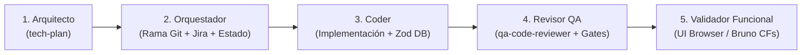

# 🚀 Skill: Orquestador de Ciclo de Vida y Subagentes (`/feature-pipeline`)

Utiliza este skill como el **director de orquesta principal** para llevar un requerimiento o ticket desde su concepción hasta su entrega validada, delegando cada etapa técnica a los **subagentes especializados** para no saturar un solo contexto y garantizar calidad de extremo a extremo.

---

## 🗺️ 1. Cadena de Subagentes de Desarrollo Continuo

Una vez que la Historia de Usuario está lista para desarrollo, el Orquestador ejecuta la cadena continua de 5 roles técnicos:



| Rol                        | Skill / Subagente que lo ejecuta                                                                                                                                                                                        | Entregable                                                                                                                                                                           |
| :------------------------- | :---------------------------------------------------------------------------------------------------------------------------------------------------------------------------------------------------------------------- | :----------------------------------------------------------------------------------------------------------------------------------------------------------------------------------- |
| **1. Arquitecto**          | [tech-plan](file:///Users/jgu7man/.gemini/config/skills/tech-plan/SKILL.md)                                                                                                                 | **Plan de Implementación** bajo estándar `marxa-digital/[scope]`, `shared/*/[scope]`, `modules/[scope]/*`, `functions/[scope]` + contratos `*.model.ts` y schemas Zod `*.schema.ts`. |
| **2. Orquestador**         | Agente Principal (`feature-pipeline` / `feature-execute`)                                                                                                                                                               | Rama `feature/<key>-<slug>`, transición en Jira, actualización de `.agents/active-feature.json` y coordinación de subagentes.                                                        |
| **3. Coder**               | Subagente `self` (y `firestore-rules-author` si toca `firestore.rules`)                                                                                                                                                 | Código implementado según el Plan, aplicando Protocolo CAT, validación Zod `.parse()`/`.safeParse()` en DB y `*.spec.ts`.                                                            |
| **4. Revisor QA**          | Subagente **`qa-code-reviewer`** + [code-review](file:///Users/jgu7man/.gemini/config/skills/code-review/SKILL.md)                                                                                          | Reporte granular `archivo:línea` (🔴/🟡/🟢) + aprobación mecánica de `nx affected -t typecheck,lint,test`.                                                                           |
| **5. Validador Funcional** | **UI:** `qa-emulator-operator` + `qa-regression-tester` / `browser` (`qa-reviewing`)<br>**CFs:** `qa-emulator-operator` + [bruno-qa](file:///Users/jgu7man/.gemini/config/skills/bruno-qa/SKILL.md) (`bru run`) | Pruebas funcionales contra emuladores locales (flujos UI y/o colecciones `.bru` en `functions/[scope]`) + **liberación obligatoria de puertos**.                                     |

---

## ⚙️ 2. Persistencia del Estado (`.agents/active-feature.json`)

Ruta en la raíz del proyecto activo: `.agents/active-feature.json`

```json
{
	"featureKey": "MPS-1042",
	"discoveryKey": "MXPD-234",
	"title": "Motor de Recálculo de Saldos y Devoluciones",
	"branch": "feature/mps-1042-recalculo-saldos",
	"currentStage": "FUNCTIONAL_QA",
	"stages": {
		"research": { "status": "COMPLETED", "docUrl": "https://..." },
		"discovery": { "status": "COMPLETED", "riceScore": 48.0 },
		"refinement": { "status": "COMPLETED", "jiraUrl": "https://..." },
		"implementationPlan": {
			"status": "COMPLETED",
			"scopes": ["modules/orders", "functions/orders"]
		},
		"development": {
			"status": "COMPLETED",
			"coderAgentId": "uuid-del-subagente-coder"
		},
		"qualityGates": {
			"status": "COMPLETED",
			"round": 2,
			"reportPath": ".agents/code-review-report.md",
			"openBlockers": 0,
			"openTechDebt": 0
		},
		"functionalQa": { "status": "IN_PROGRESS", "mode": "BRUNO_AND_BROWSER" },
		"cicd": { "status": "PENDING", "prUrl": null },
		"documentation": { "status": "PENDING", "confluenceUrl": null }
	}
}
```

> **Valores canónicos para `status` (String Enums)**:
> `PENDING`, `IN_PROGRESS`, `BLOCKED`, `COMPLETED`, `SKIPPED`.

---

## 🧭 3. Protocolo Operativo por Fase

### Fase 0: Investigación & Contexto de Entrada (`/feature-research`)

- **Acción**: Elaborar el Spike técnico previo (precedentes, scopes Nx afectados, factibilidad y riesgos).

### Fase 1: Discovery & Priorización RICE (`/jira-rice-estimation`)

- **Acción**: Evaluar Reach, Impact, Confidence y Effort calibrado al squad.

### Fase 2: Refinamiento Técnico & Creación de HU (`/jira-story-structure`)

- **Acción**: Generar la Historia de Usuario en Jira con la plantilla corporativa de 5 secciones en Markdown nativo y criterios Gherkin completos.

### Fase 3: Definición Técnica (Arquitecto) & Protocolo CAT (`/implementation-plan` + `/protocol-cat`)

- **Acción**:
  1. Salir de `develop` o `main`; crear rama `feature/<ticket>-<slug>`.
  2. Generar el **Plan de Implementación** con [tech-plan](file:///Users/jgu7man/.gemini/config/skills/tech-plan/SKILL.md):
     - Selección minimalista de librerías (`marxa-digital/[scope]`, `shared/*/[scope]`, `modules/[scope]/{api,feature,data-access,domain,ui,utils}`, `functions/[scope]`).
     - Definición de contratos `*.model.ts` y **schemas Zod `*.schema.ts`** obligatorios para DB.
     - Estrategia de `BoundaryTransformer`, componentes `OnPush` y casos de prueba.
  3. Auditar deuda técnica previa en los archivos a modificar (Protocolo CAT).

### Fase 4: Desarrollo Delegado (Subagente Coder)

- **Acción**: Invocar al subagente implementador pasándole el Plan de Implementación aprobado.
- **Reglas**:
  - Archivos Nx en `kebab-case.ts`, cero `any`, cero interfaces `*Like`, string enums obligatorios.
  - Toda escritura/lectura en DB en `data-access` o `functions/[scope]` validada con Zod (`Schema.parse` / `safeParse`).
  - Si se modifican `firestore.rules`, delegar obligatoriamente a **`firestore-rules-author`**.
  - No realizar commits a menos que el usuario lo solicite explícitamente.

### Fase 5: Bucle Iterativo de QA Code Review & Quality Gates (`qa-code-reviewer ⇄ Coder`)

- **Acción**:
  1. Invocar al subagente **`qa-code-reviewer`** (Ronda $N$) para auditar el `git diff` contra las reglas de [code-review](file:///Users/jgu7man/.gemini/config/skills/code-review/SKILL.md) y [sanitize-architecture](file:///Users/jgu7man/.gemini/config/skills/sanitize-architecture/SKILL.md), y volcar el resultado en **`.agents/code-review-report.md`** (`OPEN` / `FIXED` / `VERIFIED`).
  2. **Bucle `Revisor ⇄ Coder` (máximo 4 rondas)**:
     - Si existen hallazgos 🔴 Bloqueantes o 🟡 Deuda Técnica en estado `OPEN`, reanudar al mismo subagente Coder vía **`send_message`** (`Recipient: coderAgentId`) ordenándole leer `.agents/code-review-report.md`, reparar cada punto, marcarlo como `FIXED` y correr las pruebas.
     - Relanzar a `qa-code-reviewer` (Ronda $N+1$) hasta que `.agents/code-review-report.md` quede en `APPROVED` (`0 🔴` y `0 🟡` abiertos).
  3. Ejecutar compuertas mecánicas finales:
     - `pnpm exec nx affected -t typecheck`
     - `pnpm exec nx affected -t lint`
     - `pnpm exec nx affected -t test --coverage`
     - `pnpm exec nx format:write`

### Fase 6: Validación Funcional en Emuladores (Navegador y/o Bruno)

- **Acción**:
  1. **`qa-emulator-operator`** prepara emuladores locales y seeds.
  2. **Si hay cambios en Frontend (`feature`/`ui`/`data-access`)**: **`qa-regression-tester`** / **`browser`** inicia sesión, verifica criterios Gherkin, cálculos en pantalla y no-afectación.
  3. **Si hay cambios en Cloud Functions (`functions/[scope]`)**: ejecutar [bruno-qa](file:///Users/jgu7man/.gemini/config/skills/bruno-qa/SKILL.md) (`npx @usebruno/cli run [scope] --env emulator`) validando respuestas `200`, rechazo Zod `400`, seguridad `401/403` y documentos escritos en Firestore.
  4. **Cierre obligatorio**: `qa-emulator-operator` detiene emuladores y libera todos los puertos.

### Fase 7: CI/CD & Pull Request (`/feature-ship`)

- **Acción**: Push con `-u origin <rama>`, apertura de PR con **Squash merge** (salvo `release`/`hotfix`), vínculo en Jira (`mxd_link_pr`).

### Fase 8: Documentación Funcional en Confluence (`/doc-functional`)

- **Acción**: Publicar o actualizar la documentación operativa (Qué hace, Cómo lo hace, Dónde ocurre) en Confluence Cloud.

---

## 💻 4. Subcomandos de Navegación

- `/feature-pipeline start [IDEA O TICKET]`: Inicializa `.agents/active-feature.json`.
- `/feature-pipeline status`: Muestra la tabla de avance actual.
- `/feature-pipeline next`: Verifica compuertas de la fase actual y avanza al siguiente subagente.
- `/feature-pipeline jump [FASE]`: Salta directamente a una fase específica.
