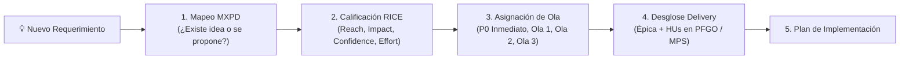

# 🧭 MXD Product Discovery & Portfolio Prioritization (MXPD)

Utiliza este skill cada vez que el usuario plantee una **nueva idea, requerimiento, dolor operativo o pendiente funcional** en el ecosistema Marxa Digital (Business Valley, ProFees, Miss Pedidos).

---

## 🎯 Objetivo del Workflow

Evitar el desarrollo desordenado o reactivo. Todo requerimiento nuevo debe pasar por el **embudo de producto** antes de tocar código:



---

## 🔍 Paso 1: Mapeo en Jira Product Discovery (`MXPD`)

Antes de crear tickets de desarrollo (`PFGO` o `MPS`):

1. **Auditar el Backlog de Discovery**:
   - Verificar si el requerimiento ya existe como Idea en el proyecto **`MXPD`** (Jira Product Discovery).
   - Ejemplos de Ideas existentes: `MXPD-10` (Cobranza y Ledger), `MXPD-15` (Campañas de Compra), `MXPD-20` (Portal de Padres).
2. **Si no existe**:
   - Proponer formalmente la nueva **Idea de Producto** en `MXPD` con:
     - **Título**: Verbo de valor + Beneficiario (ej. _Personalización Manual de Descuento Early-Bird para Administración de Escuela_).
     - **Problema a Resolver**: Dolor real en ventanilla, directivo o usuario final.
     - **Resultado Esperado**: Métrica o beneficio operativo tangible.

---

## ⚖️ Paso 2: Evaluación RICE Calibrada (Capacidad Real Marxa Digital)

Calcula la priorización RICE adaptada a la velocidad operativa real del equipo:

$$\text{RICE Score} = \frac{\text{Reach} \times \text{Impact} \times \text{Confidence}}{\text{Effort}} \times 100$$

### 1. Reach (Alcance: 1 a 10)

- **1 - 3**: Nicho muy específico (ej. un solo entrenador o caso aislado).
- **4 - 6**: Segmento operativo importante (ej. toda la ventanilla/caja o una categoría deportiva).
- **7 - 8**: Mayoría de usuarios (ej. todos los alumnos activos o tutores).
- **9 - 10**: Universal en toda la escuela o SaaS transversal.

### 2. Impact (Impacto en Negocio: 0.25 a 3)

- **0.25**: Mínimo / Cosmético.
- **0.5**: Menor / Comodidad operativa.
- **1.0**: Medio / Ahorro de tiempo recurrente.
- **2.0**: Alto / Previene errores contables, fraudes o retiene alumnos.
- **3.0**: Crítico / Transformacional / Blocker institucional.

### 3. Confidence (Confianza Técnica y de Negocio: 50% a 100%)

- **50% (0.5)**: Idea exploratoria, requisitos ambiguos, alta incertidumbre técnica.
- **80% (0.8)**: Requerimientos claros con arquitectura conocida, bajo riesgo.
- **100% (1.0)**: Especificación matemática/legal cerrada (ej. Acuerdo firmado, contrato con regla explícita).

### 4. Effort (Esfuerzo del Squad: 1 a 5)

> [!IMPORTANT]
> **Calibración de Capacidad:** El equipo está compuesto principalmente por **Jorge Guzmán (Tech Lead / QA) + Antigravity (Pair Programming)**, con apoyo auxiliar parcial y pruebas manuales directas.
> Toda estimación debe incluir un **buffer obligatorio de contingencia del 20% al 30%** para imprevistos y edge cases.

| Nivel de Esfuerzo |  Tiempo Estimado  | Complejidad / Alcance                                                                     |
| :---------------: | :---------------: | :---------------------------------------------------------------------------------------- |
|       **1**       |  **2 a 3 días**   | Ajuste en un componente existente, validación pura o helper aislado.                      |
|       **2**       |  **3 a 5 días**   | Nueva feature lib o modal con lógica en sandbox/engine y pruebas unitarias.               |
|       **3**       | **1 a 2 semanas** | Módulo completo con persistencia, Cloud Functions, reglas Firestore y vistas.             |
|       **4**       | **2 a 3 semanas** | Flujo transversal multi-pantalla, multi-tenant o refactorización arquitectónica profunda. |
|       **5**       |  **> 3 semanas**  | Épica de gran escala o producto nuevo desde cero.                                         |

---

## 🌊 Paso 3: Asignación de Ola y Prioridad en Roadmap

A partir del RICE Score y la urgencia de calendario:

| Clasificación    | Criterio de Decisión                                                               | Destino en Roadmap            |
| :--------------- | :--------------------------------------------------------------------------------- | :---------------------------- |
| **P0 Inmediato** | Blocker contable, dinero descuadrado, acuerdos firmados o fecha límite en < 48h.   | **Sprint Actual (Inmediato)** |
| **Ola 1 (P1)**   | RICE > 300 o impacto visible directo para reuniones clave (ej. Padres de Familia). | **Semana 1**                  |
| **Ola 2 (P2)**   | RICE 150 - 300 (Cierres de mes, reportes de excepción, analítica directiva).       | **Semana 2**                  |
| **Ola 3 (P3)**   | RICE < 150 (Mejoras modulares, optimizaciones deseadas no críticas).               | **Backlog Futuro (Octubre+)** |

---

## 📋 Paso 4: Desglose en Jira Delivery (Épicas y HUs)

Una vez aprobada la priorización:

1. **Regla de 3 o más HUs**: Si la Idea de MXPD requiere 3 o más Historias de Usuario, **se crea obligatoriamente una Épica en `PFGO` o `MPS`** que represente la Idea.
2. **Vinculación**: La Épica o HUs creadas deben incluir en su descripción la referencia a la Idea de Discovery:
   ```text
   h2. 🔗 Product Discovery (MXPD)
   * *Idea:* [MXPD-15|https://marxa-digital.atlassian.net/browse/MXPD-15]
   * *RICE Score:* 480 (R:8, I:2, C:0.8, E:2.5)
   * *Ola:* Ola 1 (Prioridad P0)
   ```
3. **Confirmación Previa**: **NUNCA** crear los tickets en Jira antes de que el usuario apruebe el documento de refinamiento.

---

## 📄 Formato del Resumen en el Plan

Cada propuesta de nueva funcionalidad debe incorporar esta tabla ejecutiva:

```markdown
### 🧭 Evaluación de Producto (MXPD & RICE)

| Métrica                    |   Valor Asignado    | Justificación                                      |
| :------------------------- | :-----------------: | :------------------------------------------------- |
| **Idea MXPD**              | `MXPD-XX` (o Nueva) | Nombre de la iniciativa en Discovery               |
| **Reach (Alcance)**        |      `8 / 10`       | Aplica a todos los alumnos que pagan en ventanilla |
| **Impact (Impacto)**       |    `2.0 (Alto)`     | Elimina capturas chuecas de fin de mes             |
| **Confidence (Confianza)** |    `100% (1.0)`     | Regla de negocio definida por administración       |
| **Effort (Esfuerzo)**      |   `2 (3-5 días)`    | UI simple con model signal reactivo y helper puro  |
| **RICE Score**             |       **800**       | **Prioridad P0 (Ola 1 Inmediata)**                 |
```
