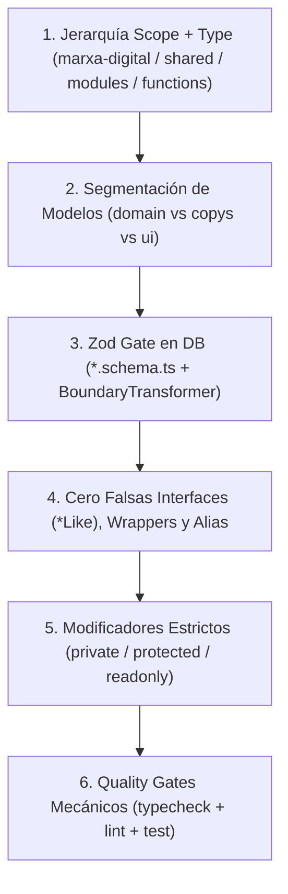
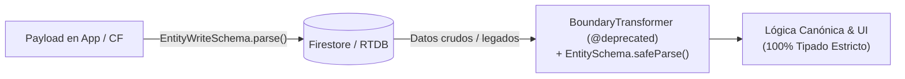

# 🛠️ MXD Architectural Sanitizer: Scopes, Modelos, Zod y Schemas Legados

Usa este skill cuando necesites auditar, sanear o refactorizar la arquitectura de librerías, contratos, schemas Zod de persistencia o separación de capas en cualquier monorepo Nx de Marxa Digital. Para planeación preventiva pre-código, este skill trabaja en conjunto con [tech-plan](file:///Users/jgu7man/.gemini/config/skills/tech-plan/SKILL.md).



---

## 🎯 Disparadores y Comandos

- `/sanitize-models`, `/audit-models`, `/architectural-sanitize`
- `"sanear modelos"`, `"separar responsabilidades de modelos"`, `"auditar interfaces Like"`, `"aislar esquemas legados"`, `"agregar schemas zod"`

---

## 📋 1. Dimensión 1: Jerarquía Agnóstica por `scope` y `type` (Module Boundaries)

Todo proyecto se estructura en **4 niveles de librerías minimalistas**, sin acoplar contratos transversales a reglas de un módulo o vertical particular:

```text
Nivel 1: marxa-digital/[scope]/{api,feature,data-access,domain,ui,utils}
         (Plataforma Core multi-proyecto — agnóstica a cualquier producto específico)
            ⬇
Nivel 2: shared/{api,feature,data-access,domain,ui,utils}/[scope]
         (Contratos y piezas transversales compartidas dentro del monorepo actual)
            ⬇
Nivel 3: modules/[scope]/{api,feature,data-access,domain,ui,utils}
         (Módulo de dominio o vertical de negocio específica)

Backend: functions/[scope]
         (Cloud Functions del scope — solo comparte contratos/schemas puros de domain y utils)
```

- **Invariante de Capas**: Queda estrictamente prohibido que conceptos de un `modules/[scope]` se filtren en `shared/*` o en `marxa-digital/*`.
- **Fronteras por `type`**:
  - `domain` nunca importa de `data-access`, `ui`, `feature` ni `api`.
  - `ui` solo importa de `domain`, `utils` y `shared/ui` (o `marxa-digital/*/ui`), nunca de `data-access` ni `feature`.
  - `data-access` importa de `domain`, `utils` y `shared/data-access`.
  - `feature` orquesta `data-access`, `ui`, `domain` y `utils`.
  - La comunicación entre dos módulos distintos (`modules/[scope-a]` $\rightarrow$ `modules/[scope-b]`) ocurre **exclusivamente** a través de `modules/[scope-b]/api`.

---

## 📦 2. Dimensión 2: Segmentación de Responsabilidades en Modelos y Schemas Zod

Queda prohibido concentrar persistencia, validación, copys y estilos visuales en un solo archivo. Todo `scope` separa sus contratos según el `type` de librería:

### 1. En `domain`: `*.model.ts` (Dominio Canónico) y `*.schema.ts` (Schemas Zod de DB)

- **`*.model.ts`**: Entidades de dominio/persistencia, DTOs, **string enums** de negocio (`export enum ...`) y tipos ID canónicos.
  - **Orden Canónico dentro de `*.model.ts`**: `1. Enums` $\rightarrow$ `2. Interfaces` $\rightarrow$ `3. Types` $\rightarrow$ `4. Constants`.
  - **Prohibido**: Clases CSS Tailwind, textos legibles para humanos o configuraciones de botones/tabs.
- **`*.schema.ts`**: Esquemas **Zod** que gobiernan todo lo que se guarda y lee de la base de datos (Firestore/RTDB) o cruza fronteras de Cloud Functions:
  - Usar siempre `z.nativeEnum(MyStringEnum)` para validar catálogos canónicos.
  - Exponer schemas de lectura y escritura (`EntitySchema`, `EntityWriteSchema`) sincronizados con la interfaz canónica.

### 2. En `ui`: `*-copys.model.ts` (Diccionarios de Texto & Copys)

- **Contenido**: Mapeos de enums a strings legibles (`Record<EnumType, string>`), textos descriptivos y plantillas de mensajes.
- **Prohibido**: Esquemas de base de datos o lógica de persistencia.

### 3. En `ui`: `*-ui.model.ts` (Presentación & Modelos de Vista)

- **Contenido**: View Models (`*ViewItem`), tabs (`*TabEnum`), filtros interactivos, configuraciones de píldoras/badges (`Record<EnumType, VisualConfig>`) y opciones de select.
- **Prohibido**: Payloads crudos de base de datos.

---

## 🛡️ 3. Dimensión 3: Persistencia Segura con Zod y Patrón `BoundaryTransformer`

Para evitar documentos corruptos o heterogéneos en DB, toda operación en `data-access` y `functions/[scope]` debe cumplir:



1. **Write Gate Obligatorio (`Schema.parse`)**:
   - Prohibido guardar en Firestore/RTDB objetos casteados con `as Entity` o sin validar. Toda escritura (`set`, `add`, `update`) debe pasar por `Schema.parse(payload)` antes de enviarse a DB.
2. **Read Gate & Normalización de Legados (`BoundaryTransformer` + `safeParse`)**:
   - Prohibido dispersar `if (raw.status === 'OLD_VALUE')` en componentes, pipes o engines.
   - Si existen datos históricos en DB con formato antiguo, crear un `BoundaryTransformer` puro en `data-access` (marcado con `@deprecated` y acompañado de su script `scripts/migrate-*.ts`) que normalice el payload crudo hacia el contrato canónico validado con Zod.
   - Una vez migrada la base de datos, el `BoundaryTransformer` se elimina en 1 commit sin tocar componentes ni engines.

---

## 🚫 4. Dimensión 4: Erradicación de Falsas Interfaces (`*Like`), Alias y Wrappers

- **Cero Interfaces `*Like`**: Prohibido crear clones duck-typed (`OrderLike`, `UserLike`, `PlanLike`) para simular desacoplamiento.
  - Reutilizar siempre el contrato canónico desde `domain`.
  - Si una función solo requiere un subconjunto de propiedades, usar `Pick<Entity, 'id' | 'status'>` u `Omit<Entity, 'audit'>`.
- **Cero Alias de Exportación Redundantes**: Prohibido re-exportar constantes o tipos con nombres duplicados (`export const ALIAS_CONFIG = DEFAULT_CONFIG;`).
- **Cero Wrappers de Una Sola Línea**: Prohibido crear getters o `computed(() => this.engine.value())` que solo reenvían una señal; exponer `protected readonly engine = inject(...)` y consumirlo directamente en la plantilla.
- **Higiene de Exportación**: Acumuladores de `reduce` o interfaces internas de un helper deben permanecer **no exportados** dentro de su archivo.

---

## ⚡ 5. Dimensión 5: Modificadores de Acceso y Extensión Tipada

- `private`: Estado interno y métodos exclusivos de la clase.
- `protected`: Exclusivamente propiedades/signals/servicios consumidos por la plantilla HTML.
- `public`: APIs expuestas formalmente a otros consumidores.
- `readonly`: Obligatorio en todo `inject()`, signal, input, constante o referencia inmutable.
- **Herencia Tipada (`extends`)**: Extender de interfaces base canónicas en lugar de duplicar bloques de propiedades.

---

## 🧩 6. Dimensión 6: Desacoplamiento White-Label (`DomainColumnConfig` & Slots)

Cuando un componente agnóstico en `marxa-digital/[scope]/ui` o `shared/ui/[scope]` deba renderizar columnas, atributos o secciones que varían según el módulo/vertical (`modules/[scope]`):

1. **Cero Campos de Vertical Hardcodeados en Capas Superiores**: Los atributos especializados viajan en `domainAttributes?: Record<string, unknown>` o se proyectan vía slots `<ng-content select="[slot-name]" />`.
2. **Inyección Declarativa de Columnas (`DomainColumnConfig`)**:
   ```typescript
   export interface DomainColumnConfig {
   	readonly attributeKey: string; // ej. 'jerseyNumber' o 'instrument'
   	readonly headerLabel: string; // ej. 'Dorsal' o 'Instrumento'
   	readonly prefix?: string; // ej. '#'
   	readonly align?: "left" | "center" | "right";
   	readonly searchable?: boolean;
   }
   ```
   El módulo específico provee su configuración por `InjectionToken` sin acoplar la tabla ni el modelo compartido.
3. **Renderizado Declarativo en HTML**:
   - Encabezados: `@for (col of domainColumns(); track col.attributeKey) { <th [ngClass]="col.alignClass">{{ col.headerLabel }}</th> }`
   - Celdas: `@for (col of domainColumns(); track col.attributeKey) { @let val = st.domainAttributes?.[col.attributeKey]; <td>{{ val !== undefined ? (col.prefix ?? '') + val : '-' }}</td> }`
4. **Búsqueda Dinámica por Atributos**:
   - El filtro de búsqueda evalúa dinámicamente si el query coincide con alguna de las columnas marcadas como `searchable: true`.
5. **Cuándo Usar**:
   - Usar siempre que la vertical consuma directamente el componente agnóstico por ruta (`loadComponent`) sin requerir un wrapper `Thin View` propio con `ng-content`, eliminando taladros innecesarios de slots a través de múltiples niveles de componentes.

---

## 🔬 7. Diagnóstico Arquitectónico Inverso desde Pruebas (`Test Smell -> Architecture Fix`)

Un test unitario que duele al escribirse o exige simular fallos irreales es una alerta temprana de arquitectura:

1. **Lógica pura o algoritmos de negocio ocultos en I/O (`data-access`)**: Todo `.filter/.map/.sort`, cálculo o algoritmo puro (incluidos métodos `private` como sorteos, validaciones de dominio o mappers) atrapado dentro de llamadas a Firestore/HTTP en `data-access` —aun en archivos movidos o migrados— debe reportarse y extraerse a un helper o engine puro en `domain` o `utils` mediante TDD (primero `*.spec.ts`, luego extracción) y reflejarse en `business-specs.md`.
2. **Validación silenciosa que enmascara contratos**: Si en un test de componente o engine surge la tentación de inventar un `throw` porque la dependencia real retorna `false` (ej. descarga fallida) o ignora arreglos vacíos, la arquitectura carece de un **contrato explícito de resultado o falla** (`ActionResult<T>` / guarda `if (!res.success)`). Debe corregirse en producción tras escribir el test realista fallando (Red → Green).
3. **Orquestadores con efectos cruzados sin frontera**: Si probar un flujo obliga a usar contexto multi-dominio para un solo método, evaluar si las sub-responsabilidades deben separarse en comandos independientes.
4. **Specs acoplados al código técnico o sin inventario de negocio**: Todo `*.spec.ts` auditado o generado durante el saneamiento debe redactar sus `it('should ...')` desde la garantía de negocio o experiencia de usuario (incluyendo validación de schemas Zod, no desde retornos técnicos triviales), mantener independencia unitaria por archivo (sin omitir reglas propias ni probar librerías externas/pasamanos triviales) y reflejarse en el `business-specs.md` de la librería; ante cualquier brecha, proponer los cambios de mejora en la revisión.

---

## 🧪 8. Protocolo de Ejecución de Saneamiento en 4 Pasos

```bash
# Paso 1: Detectar falsas interfaces *Like, casts inseguros en DB y alias redundantes
grep -rn "Like " libs/
grep -rn " as " libs/

# Paso 2: Segmentar modelos (domain: *.model.ts + *.schema.ts | ui: *-copys.model.ts + *-ui.model.ts)

# Paso 3: Verificar typecheck, boundaries y pruebas unitarias en proyectos afectados
pnpm exec nx affected -t typecheck,lint,test

# Paso 4: Formateo determinista
pnpm exec nx format:write
```
