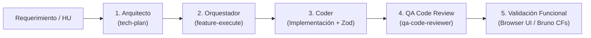

# 📐 JG7 Implementation Plan & Technical Definition (`tech-plan`)

Este skill actúa como el **Arquitecto Shift-Left** dentro de la cadena de desarrollo continuo. Su misión es diseñar la **Definición Técnica / Plan de Implementación** *antes* de que el subagente Coder escriba una sola línea de código, asegurando que las reglas de arquitectura ([sanitize-architecture](file:///Users/jgu7man/.gemini/config/skills/sanitize-architecture/SKILL.md)) y calidad ([code-review](file:///Users/jgu7man/.gemini/config/skills/code-review/SKILL.md)) nazcan desde el plano y no como correcciones post-código.



---

## 🎯 Disparadores

- `/implementation-plan`, `/tech-def`, `/plan`
- `"definición técnica"`, `"plan de implementación"`, `"diseña el plan técnico"`
- Invocado automáticamente como **Paso Pre-Código** por `feature-execute` y `feature-pipeline`.

---

## 🏛️ 1. Estándar Agnóstico de Librerías Nx por `scope` y `type`

Todo Plan de Implementación es **agnóstico del proyecto** (aplica igual a `miss-pedidos`, `nx-monorepo`, `core-product` o cualquier monorepo futuro) y organiza el código en **4 niveles jerárquicos** con librerías minimalistas:

### Niveles Jerárquicos (`Scope Hierarchy`)
```text
1. jg7/[scope]/{api,feature,data-access,domain,ui,utils}
   └── Core transversal multi-proyecto de JG7.
       🚫 Prohibido importar de shared/*, modules/* o functions/*.

2. shared/{api,feature,data-access,domain,ui,utils}/[scope]
   └── Piezas transversales compartidas dentro del monorepo actual.
       ✅ Puede importar de jg7/*. 🚫 Prohibido importar de modules/*.

3. modules/[scope]/{api,feature,data-access,domain,ui,utils}
   └── Módulo de dominio/negocio específico.
       ✅ Puede importar de jg7/*, shared/* y de modules/[otro-scope]/api.
       🚫 Prohibido importar internos (feature, data-access, ui, domain) de otro módulo.

4. functions/[scope]
   └── Cloud Functions, triggers y endpoints backend del scope.
       ✅ Solo comparte contratos, schemas Zod y helpers puros desde domain o utils.
       🚫 Prohibido importar de ui o feature.
```

### Responsabilidad Estricta por `type`
| Tipo (`type:*`) | Qué vive aquí | Qué tiene prohibido |
| :--- | :--- | :--- |
| **`domain`** | Contratos canónicos (`*.model.ts`), **schemas Zod de DB (`*.schema.ts`)**, string enums y lógica/engines puros sin I/O. | Importar `data-access`, `ui`, `feature`, SDKs de Firebase/HTTP o clases CSS. |
| **`data-access`** | Servicios de persistencia (Firestore/RTDB/HTTP), stores, validación Zod `.parse()`/`.safeParse()` y `BoundaryTransformer`. | Componentes visuales, lógica de presentación o escrituras a DB sin pasar por Zod. |
| **`ui`** | Componentes presentacionales (`OnPush`, `input.required`), `*-ui.model.ts` y `*-copys.model.ts`. | Inyectar servicios de `data-access` o mutar estado global directamente. |
| **`feature`** | Páginas / smart components (`*PageComponent`) y rutas que conectan `data-access` + `domain` + `ui`. | Superar 250 líneas de HTML (debe extraer moléculas hacia `ui`). |
| **`api`** | Fachada pública (contratos o servicios expuestos) para que otros `modules/[otro-scope]` interactúen con este scope. | Exponer detalles internos de implementación o modelos de vista (`*-ui.model.ts`). |
| **`utils`** | Funciones puras, formateadores y Pure Pipes reutilizables. | Estado mutable o efectos secundarios (I/O). |

> **Regla de Minimalismo:** Antes de proponer crear una librería nueva, audita las librerías existentes del `scope`. Solo se crea una librería si el `type` aún no existe y es estrictamente necesario.

---

## 🛡️ 2. Regla Inquebrantable: Zod para Todo lo que se Guarda o Lee de DB

Para evitar corrupción de datos y documentos heterogéneos en Firestore/RTDB, **todo plan que involucre base de datos o payloads de Cloud Functions debe especificar sus schemas Zod**:

1. **Ubicación Canónica (`domain`)**:
   - Todo contrato persistido en DB (`*.model.ts`) debe tener su schema Zod hermano en `*.schema.ts` dentro de `domain` (`jg7/[scope]/domain`, `shared/domain/[scope]` o `modules/[scope]/domain`).
2. **String Enums + Zod**:
   - Declarar siempre catálogos como `export enum StatusEnum { ... }` y validarlos en Zod con `z.nativeEnum(StatusEnum)` (nunca union types sueltos).
3. **Write Gate (`Schema.parse`)**:
   - En `data-access` y `functions/[scope]`, toda operación `set`, `add`, `update` o batch hacia DB **debe** validar el payload con `EntityWriteSchema.parse(payload)` antes de persistir. Prohibido guardar objetos casteados con `as Entity`.
4. **Read Gate & Legados (`Schema.safeParse` + `BoundaryTransformer`)**:
   - Al leer documentos de DB o recibir requests en `functions/[scope]`, validar con `safeParse`. Si existen esquemas históricos legados en DB, el plan debe incluir un `BoundaryTransformer` en `data-access` que normalice el dato crudo antes o dentro del schema Zod.

---

## 📋 3. Plantilla Obligatoria de Definición Técnica / Plan de Implementación

Cada vez que generes un plan técnico, estructura la salida con estas **5 secciones concretas** (sin relleno teórico):

### Sección 1: Mapa de Scopes y Librerías Impactadas
Lista exactamente qué librerías se modifican o crean siguiendo `kebab-case.ts`:
- `jg7/[scope]/...`
- `shared/[type]/[scope]/...`
- `modules/[scope]/{domain,data-access,ui,feature,api,utils}/...`
- `functions/[scope]/...`

### Sección 2: Contratos, String Enums y Schemas Zod (`domain` vs `ui`)
- **En `domain` (`*.model.ts` y `*.schema.ts`)**:
  - Qué `enum` (string enum) e `interface` canónicos se reutilizan o extienden (`extends`, `Pick<T, K>`, `Omit<T, K>`). **Cero interfaces `*Like` y cero `any`**.
  - Qué schemas Zod (`*Schema`, `*CreateSchema`, `*UpdateSchema`) protegerán la escritura y lectura en DB.
- **En `ui` (`*-copys.model.ts` y `*-ui.model.ts`)**:
  - Diccionarios de texto (`Record<EnumType, string>`) y configuraciones visuales de badges/píldoras (`Record<EnumType, VisualConfig>`).
- **Desacoplamiento / White-Label (si aplica)**:
  - Si un componente en `shared/ui` o `modules/[scope]/ui` requiere columnas o slots variables, especificar el uso de `DomainColumnConfig` o `<ng-content>` para no contaminar capas superiores.

### Sección 3: Flujo de Datos, Engines y Cloud Functions (`data-access` & `functions`)
- **Persistencia (`data-access`)**: métodos del repositorio/servicio, dónde se invoca `Schema.parse()` al guardar y si requiere `BoundaryTransformer` (`@deprecated`) para datos legados.
- **Lógica de Negocio (`domain` / `*Engine.ts`)**: qué cálculos o transformaciones viven en un Engine headless o helper puro (fuera del componente y fuera del callback de I/O).
- **Backend (`functions/[scope]`, si aplica)**: nombre de la función, validación de entrada con Zod, verificación de autenticación/RBAC y efectos atómicos en DB.

### Sección 4: Topología de Componentes Angular (`feature` & `ui`)
- **Smart Component (`feature`)**: qué signals o resources consume directamente del Engine/Store (**cero wrappers de una sola línea**).
- **Moléculas Presentacionales (`ui`)**: descomposición para que ningún template supere **250 líneas**, usando `ChangeDetectionStrategy.OnPush`, `input.required<T>()`, `@let` para capturar signals en HTML, **Pure Pipes** (cero llamadas a métodos en plantillas) y eventos de accesibilidad (`(keyup.enter)`, `aria-label`).

### Sección 5: Plan de Verificación para Subagentes de QA
Define los criterios exactos que ejecutarán los subagentes posteriores:
1. **Unit Tests (`*.spec.ts`)**: qué escenarios de negocio reales (`describe('Cuando...')` + `beforeEach` + `it`) se probarán en `domain`, `utils`, `data-access` y `functions/[scope]` (incluyendo rechazo de payloads inválidos por Zod).
2. **QA Code Review (`qa-code-reviewer`)**: verificación de `nx affected -t typecheck,lint,test`, module boundaries y cumplimiento de Zod en DB.
3. **Validación Funcional**:
   - **Si toca UI**: flujos y cálculos que validará `qa-regression-tester` / `browser` en emulador.
   - **Si toca `functions/[scope]`**: casos `.bru` (Happy Path 200, Zod Rejection 400, Auth/RBAC 401/403) que ejecutará [bruno-qa](file:///Users/jgu7man/.gemini/config/skills/bruno-qa/SKILL.md).
